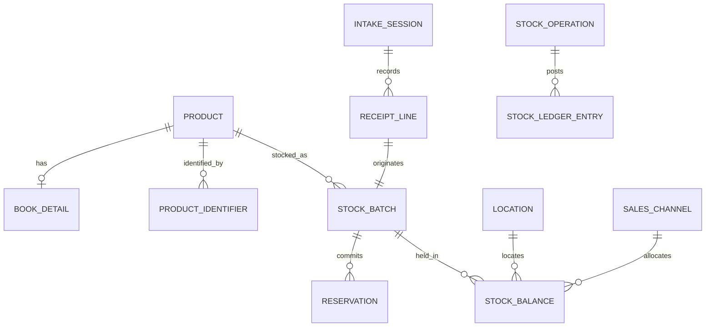

# Proposed data model and invariants

This is the target conceptual model. Applied migrations currently cover catalogue/configuration, intake sessions, receipt lines, stock batches, balances and receipt ledger entries. BookDetail and one selected ProductImage per product are also implemented. General ProductIdentifier, StockOperation, sales/reservations/counts and integration-task entities remain future work. Actual receipt financial precision and tax handling are recorded in decisions.md.

## Entities

| Entity | Responsibility and relationships |
| --- | --- |
| Product | Internal unique SKU, product type, display name, category, catalogue defaults; has many identifiers and stock batches |
| ProductIdentifier | Scheme and normalised value; canonical ISBN-13 links equivalent ISBN-10; unique scheme/value |
| BookDetail | Optional one-to-one book metadata: authors, publisher, language, format, edition; other product types do not require this |
| Category | Catalogue classification, independent from product type and physical location |
| ProductImage | Selected/uploaded image, provider attribution, original URL, provenance, review state |
| Supplier | Delivery source; no inventory balance |
| Location | Physical storage/place; named shop, stockroom, fair box, website shelf |
| SalesChannel | Exclusive selling purpose; website, shop, named event; independent of Location |
| IntakeSession | Supplier/reference, defaults, destinations, lifecycle, creator/closer, revision |
| IntakeDestination | Session's selected channel, physical destination and separation setting |
| ReceiptLine | Intake, product, quantity, cost input/basis, financial snapshots, condition, actor, idempotency reference |
| StockBatch | Product, originating receipt/opening entry, condition, unit cost basis/snapshot, selling price/currency, sales tax snapshot |
| StockOperation | Operation type, actor, timestamps, reason/reference, idempotency key, reversal link |
| StockLedgerEntry | Signed delta per batch/location/channel/status attached to an operation |
| StockBalance | Transactionally maintained quantity for one batch/location/channel/status bucket; supports row locking |
| Reservation | Batch/location/channel, quantity, state, reference, actor and optional expiry |
| RecordedSale / SaleLine | Actual sales channel, source batch/allocation, quantity, actual price/tax snapshot; inventory record only |
| ExternalStockTask | Manual Squarespace update to perform, associated operation, pending/completed state |
| CountSession / CountLine | Count snapshot, actual quantity, intervening movement handling, approved reconciliation |

Unallocated is a deliberate bucket, not missing input. Use a non-null internal bucket identifier (or equivalent database uniqueness design) so NULL uniqueness cannot create multiple supposedly identical unallocated balances.

Store sellability/status separately from channel: damaged stock cannot become available merely because it has a shop allocation. Bookfair event identity must survive the end of the event.

## Relationships

Some batches originate in opening stock rather than supplier receipts; the schema must permit that explicitly.

## Quantity rules

For a sellable batch/location/channel bucket:

`available = on_hand - active_reserved`

For a batch/location:

`sellable_on_hand = sum(channel buckets including unallocated)`

Reservations are a subset of on-hand, not extra copies. Non-sellable stock contributes to owned stock but not availability. A receipt's original received quantity is historical; it must not decrease when later copies sell.

Required invariants:

1. On-hand, active reserved, and available cannot be negative; reserved cannot exceed sellable on-hand.
2. A receipt's channel splits sum exactly to its quantity, including explicit unallocated.
3. Transfers conserve owned quantity; reallocations conserve on-hand and physical location.
4. Sales and supplier returns decrease stock once; reservation creation alone does not.
5. Fulfilment consumes stock and commitment atomically and cannot repeat.
6. A write retry cannot append a duplicate receipt, movement, reservation, or sale.
7. All balance changes have ledger entries, user attribution, and an operation reference.
8. Posted history is not edited/deleted; reversals reference the original operation and respect subsequent stock use.
9. Different costs, conditions, or prices for one ISBN remain distinguishable.
10. Concurrent requests cannot oversell or overwrite a stale correction.

## Financial rules

Store monetary values as fixed-precision decimals (or carefully chosen minor-unit representation where sufficient), explicit currency, tax basis, and historical tax snapshots. Unit costs may need more precision than customer prices, especially when deriving them from a line total. Preserve original totals and define remainder rounding before implementation.

Do not apply changed tax configuration retroactively to historical receipts/sales. Do not infer an accounting valuation method merely from the batch selection order. Inventory reporting and legal accounting/till compliance are separate concerns.

## Implemented book enrichment

BookDetail stores author_names, publisher, published_date text, format, language, metadata_source, source_url, needs_review and updated_by. ProductImage stores either an allowlisted external_url with provenance or a public storage_path, plus selected_by. Both have a unique product foreign key. Product.catalogue_version changes on product/detail/image edits and prevents a stale intake draft overwriting another staff member's changes. General image galleries and identifier tables remain future work.

## Cover edition provenance

ProductImage now has match_type (exact, alternative or upload) and nullable edition_isbn. source_url identifies the selected provider edition. These fields describe the chosen image; Product.isbn continues identifying the physical book being received.

## Web image provenance

ProductImage.match_type also accepts web. Such images retain the original public HTTPS external_url and source_url with source=Brave Image Search; edition_isbn stays null. Provider thumbnails are previews, not persisted copies or proof of an exact edition.

## Descriptions and provider modes

Product.description is nullable plain text, shared by books and other products. Intake and Products validate up to 20,000 characters. Description changes participate in catalogue version protection.

LookupProvider contains immutable registered key/name, metadata_mode, image_mode, updated_by and timestamps. Registered adapters define supported capabilities and credential configuration; secrets are not stored in these rows.
